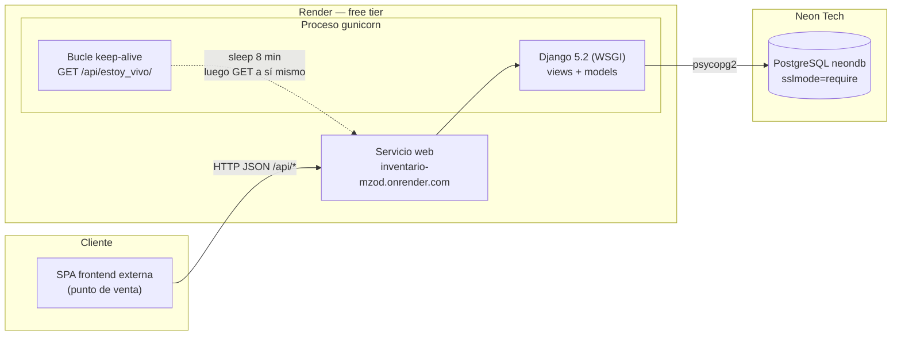
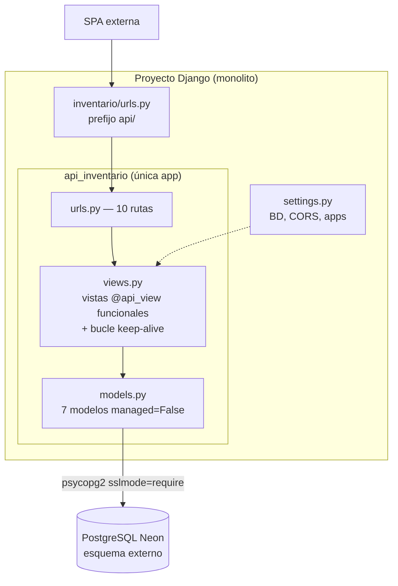

# ARQUITECTURA — Proyecto "inventario"

> Documento vivo registrado el 2026-11-07 a partir de la lectura del código (sin modificarlo). Complementa: [`README.md`](../README.md) (operación), [`GLOSARIO.md`](GLOSARIO.md) (dominio), [`DIAGRAMAS.md`](DIAGRAMAS.md) (diagramas canónicos) y [`ADRs/`](ADRs/) (decisiones).

## 1. Visión general

| Aspecto | Valor |
|---|---|
| Estilo arquitectónico | **Monolito backend-only** expuesto como API REST HTTP/JSON |
| Frontend | No incluido; lo consume una SPA externa (puntos de venta) |
| Capa de API | Vistas funcionales DRF `@api_view` — sin ViewSets, sin serializers, sin capa de servicios |
| Persistencia | PostgreSQL administrado en **Neon Tech**, esquema creado y gestionado **fuera** de Django |
| Modelos | 7 modelos `managed=False` (generados con `inspectdb`), sin migraciones aplicables |
| Autenticación | Login casero RUT+clave en texto plano; sin tokens, sesiones ni permisos en el resto de endpoints |
| Despliegue | Render free tier (gunicorn + WSGI), con keep-alive in-request |
| Tests | Ninguno (`tests.py` vacío) |
| Admin de Django | Vacío (`admin.py` sin registros) |

La aplicación gestiona el inventario y las ventas de un negocio con productos de tres dueños (Mireya, Ivan, Paulina), clasificados por tipo (Ropa, Paquetería, Útiles escolares), ubicación física y puestos de venta. El dominio completo se define en [`GLOSARIO.md`](GLOSARIO.md).

## 2. Stack y runtime

- **Django 5.2.3 + DRF 3.16.0**, driver `psycopg2-binary 2.9.10` con `sslmode=require` fijo en settings.
- **python-decouple 3.8** para el `.env` — pero **todas las variables de BD tienen defaults hardcodeados** en `settings.py` (incluida la contraseña real).
- **gunicorn 21.2.0** como servidor WSGI en Render; **whitenoise** instalado pero con su middleware comentado.
- **django-cors-headers 4.7.0** con `CORS_ALLOW_ALL_ORIGINS=True`.
- **requests** para el bucle keep-alive.

## 3. Diagrama de arquitectura de despliegue

## 4. Diagrama de componentes

## 5. Decisiones clave

| ADR | Decisión | Efecto principal |
|---|---|---|
| [ADR-001](ADRs/ADR-001-modelos-unmanaged-bd-neon-externa.md) | Modelos `managed=False` contra la BD Neon externa | El esquema vive fuera del repo; Django no crea ni migra tablas |
| [ADR-002](ADRs/ADR-002-ventas-desnormalizadas-string.md) | Productos vendidos serializados como string `"id_cantidad;..."` en `ven_productos` | Insert trivial; lectura costosa y sin integridad referencial |
| [ADR-003](ADRs/ADR-003-autenticacion-rut-clave-plana.md) | Autenticación por RUT+clave plana, sin tokens ni hashing | Cero fricción; cero seguridad real; endpoints mutantes públicos |
| [ADR-004](ADRs/ADR-004-keep-alive-render-free-tier.md) | Keep-alive in-request (sleep 8 min + auto-GET) contra el sleep de Render | Servicio despierto a costa de bloquear permanentemente un worker |

## 6. Flujo de datos relevante

1. **Registro de venta** (`crear_venta`): la SPA envía `arr` con líneas `{pro_id, pro_cantidad, pro_subtotal, puesto}`. El backend **no recalcula precios al vender**: confía en el `pro_subtotal` del cliente y serializa los productos como `"id_cantidad;..."`. El monto guardado (`ven_monto_total`) es la suma de esos subtotales.
2. **Reporte diario** (`totales_vendidos_por_dia`): se parsea el string de cada venta, se reconsulta cada producto (patrón N+1) y se **recalcula** el monto aplicando ofertas formato `"NxM"`; el resultado se distribuye por dueño y tipo usando **IDs hardcodeados**. Puede divergir de `ven_monto_total` si precios u ofertas cambiaron después de la venta.
3. **Hardcodes de negocio** (ver [`GLOSARIO.md`](GLOSARIO.md)): dueños `1=Mireya, 2=Ivan, 3=Paulina`; tipos `1=Ropa, 2=Paquetería, 3=Útiles`; ubicación `1` fija en `listar_productos`; URL del keep-alive hardcodeada en `views.py`.

## 7. Deuda técnica y riesgos

Hallazgos identificados por revisión de código (2026-11-07):

| # | Hallazgo | Severidad | Impacto |
|---|---|---|---|
| R1 | Credenciales de la BD Neon y `SECRET_KEY` **hardcodeadas como defaults** en `settings.py` y expuestas en el repo público | **Crítico** | Acceso completo a la base de datos por terceros. **Rotar inmediatamente** |
| R2 | `DEBUG=True`, `ALLOWED_HOSTS=['*']`, `CORS_ALLOW_ALL_ORIGINS=True` en producción | **Crítico** | Páginas de error con trazas y configuración filtradas; la API es consumible desde cualquier origen |
| R3 | Claves de usuario en **texto plano**, login sin tokens, y el resto de endpoints **sin autenticación ni permisos** | **Crítico** | Cualquier anónimo puede crear/editar productos y registrar ventas; claves legibles en la BD |
| R4 | `editar_producto` ejecuta `update(**prod)` con el payload JSON directo (**mass assignment**, sin whitelist) | Alto | Un cliente puede escribir columnas arbitrarias (precio, cantidad, FKs de dueño/tipo/ubicación) |
| R5 | `listar_productos`: sin el query param `buscar`, la variable `productos` nunca se define → **`UnboundLocalError` (500)** | Alto | El endpoint principal de consulta falla en su modo por defecto |
| R6 | `crear_venta` obtiene `puesto` del **último elemento** del array de productos | Medio | Bug latente: si el formato del array cambia, el puesto se pierde o la venta rompe |
| R7 | Keep-alive: cada `GET /api/estoy_vivo/` **bloquea un worker ~8 minutos** y se auto-llama (bucle infinito in-request) | Medio | Capacidad de atención reducida de forma permanente; frágil tras reinicios del proceso |
| R8 | `ven_productos` como string sin FK (límite de 100 caracteres) + IDs de dueño/tipo hardcodeados en el reporte | Alto | Sin integridad referencial; el reporte diario se corrompe si cambian catálogos o precios; pocas líneas por venta |
| R9 | Sin tests, sin serializers/validación de entrada, sin paginación, sin manejo de errores uniforme | Alto | Regressiones indetectables; entradas malformadas producen 500 con detalle interno (DEBUG on) |
| R10 | `crear_producto`: `precio_oferta.replace()` se ejecuta **fuera del try** → 500 sin manejar si el campo viene `None` | Medio | Alta de producto sin oferta falla de forma no controlada |
| R11 | `traer_usuarios` expone RUTs sin auth; whitenoise instalado sin usarse | Medio | Superficie de exposición innecesaria; dependencia muerta |

## 8. Recomendaciones priorizadas

### P0 — Seguridad inmediata (bloqueante)

1. **Rotar credenciales de Neon y la `SECRET_KEY`**; eliminar todos los `default=` de `config()` y configurar las variables en Render.
2. `DEBUG=False`; `ALLOWED_HOSTS` con el dominio real; CORS restringido a los orígenes del frontend.
3. Hashear claves con los hashers de Django (`make_password` / `check_password`) y migrar los usuarios existentes; proteger los endpoints mutantes con al menos un token compartido o sesión.
4. Whitelist explícita de campos en `editar_producto` (o migrar a un serializer con `fields` declarados).

### P1 — Corrección funcional (corto plazo)

5. Corregir `listar_productos`: responder lista vacía o 400 cuando no llegue `buscar`.
6. Enviar `puesto` como campo explícito del payload de `crear_venta` (no del último elemento del array).
7. Introducir serializers DRF para validar entrada y un manejo de errores uniforme; agregar manejo del caso `precio_oferta=None` en `crear_producto`.
8. Suite mínima de tests de regresión sobre los endpoints críticos (login, crear venta, reporte diario) con CI.

### P2 — Evolución (mediano plazo)

9. Normalizar las ventas: tabla `venta_detalle` con FK a productos y ventas; FKs reales en productos; evaluar migrar el esquema a modelos `managed` para gobernarlo desde el repo.
10. Reemplazar el keep-alive in-request por un cron externo (Render Cron Job o servicio tipo cron-job.org cada 10 minutos).
11. Paginación en los listados; logging estructurado; quitar o restringir `traer_usuarios`; remover dependencias muertas (whitenoise si no se usa).