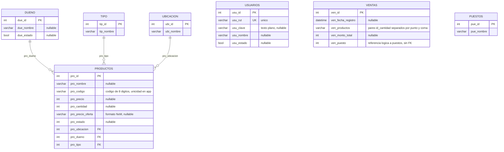
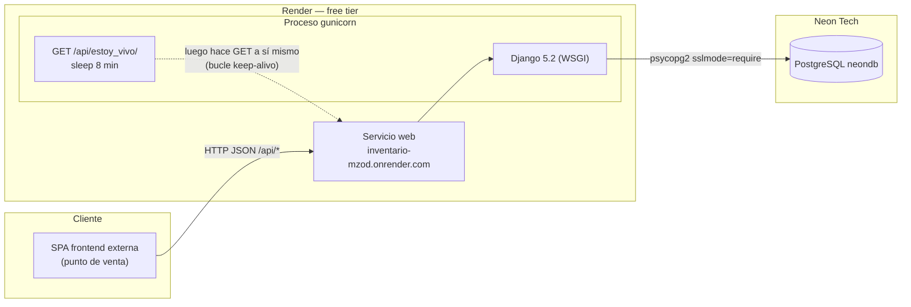
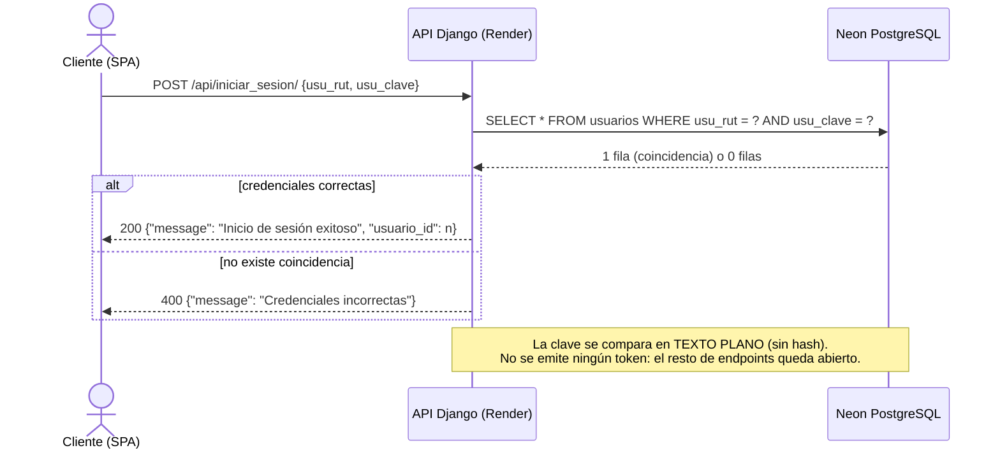
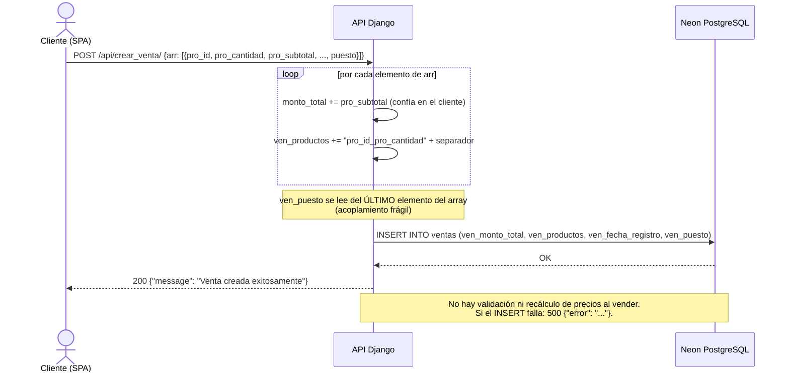

# DIAGRAMAS — Proyecto "inventario"

Diagramas en sintaxis **Mermaid** (renderizables en GitHub, VS Code y mermaid.js). Registrados el 2026-11-07 a partir del código real.

## 1. Modelo de datos (ERD)

Entidades de `api_inventario/models.py` (todas `managed=False` sobre la BD Neon externa):



**Relaciones reales (FK en BD)**: `Productos → Ubicacion`, `Productos → Dueno`, `Productos → Tipo`.

**Sin clave foránea**:

- `Ventas.ven_productos` referencia a productos vía el **string** `id_cantidad;...` (ADR-002).
- `Ventas.ven_puesto` es un entero que referencia **lógicamente** a `Puestos`, sin FK.
- `Usuarios` es totalmente independiente del resto del modelo.

## 2. Arquitectura / despliegue



El bucle `-.->` del keep-alive es **auto-sostenido**: la primera llamada externa dispara un ciclo infinito de peticiones cada ~8 minutos que mantiene despierto el servicio (ADR-004), a costa de bloquear un worker.

## 3. Secuencia — iniciar_sesion



## 4. Secuencia — crear_venta



## 5. Secuencia — totales_vendidos_por_dia

```mermaid
sequenceDiagram
    actor U as Cliente (SPA)
    participant A as API Django
    participant DB as Neon PostgreSQL
    U->>A: GET /api/totales_vendidos_por_dia/?fecha=YYYY-MM-DD
    Note over A: Sin fecha → usa hoy (datetime.now del servidor, UTC)
    A->>DB: SELECT * FROM ventas WHERE date(ven_fecha_registro) = fecha
    DB-->>A: ventas del día
    loop por cada venta
        A->>A: total_vendido += ven_monto_total
        A->>A: split(";") → pares id_cantidad
        loop por cada par id_cantidad
            A->>DB: SELECT producto por pro_id (N+1)
            DB-->>A: pro_precio, pro_precio_oferta, pro_tipo_id, pro_dueno_id
            A->>A: recalcular monto con oferta "NxM"<br/>(grupos de oferta + restantes a precio normal)
            A->>A: acumular por dueño (1=Mireya, 2=Ivan, 3=Paulina)<br/>y por tipo (1=Ropa, 2=Paquetería, 3=Útiles)
        end
    end
    A-->>U: 200 {"respuesta": {fecha, total_vendido, vendido_mireya, vendido_ivan, vendido_paulina, vendido_ropa, vendido_paqueteria, vendido_utiles, productos[]}}
    Note over A: Puede divergir de ven_monto_total si precios u ofertas<br/>cambiaron después de la venta (ADR-002).
```

## 6. Mantener los diagramas

- Si cambia el esquema de la BD (fuera de Django), actualizar primero `models.py`, luego este documento y [`ARQUITECTURA.md`](ARQUITECTURA.md).
- Regla práctica: **todo cambio de contrato de un endpoint** (ruta, payload, respuesta) exige actualizar el diagrama de secuencia correspondiente y la tabla de endpoints del `README.md`.